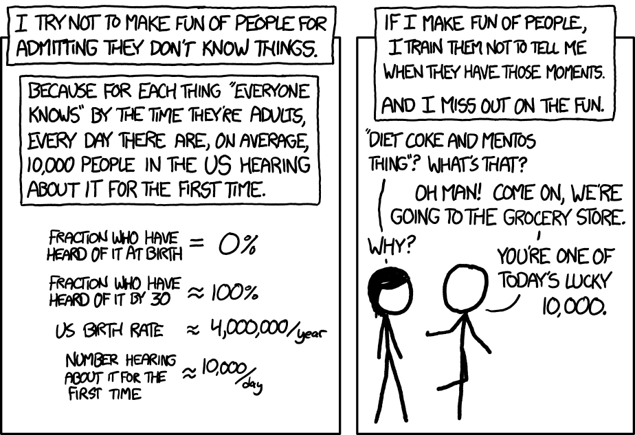

# InfoSec Reference
### Any communicaitons occuring within the United States should be viewed as compromised and no privacy guaranteed unless E2EE was used and verified(Not new). 
### (New: The US gov now has legal authority to compel recording or monitoring by any citizen within the United States, regardless of their proximity or interaction with the supposed crime being monitored. Among the other issues made possible/enabled through passage of the legislation) I have kept this project non-political, but this is absolutely terrible. 
### Full support by Biden and his administration as well shows that this is not some partisan issue(Those who claim so, don't be a useful idiot). 
### I understand that people seem to think I'm a clown, so hopefully this entertainment will help keep this in mind when relevant. There is no other clearer sign of the corruption and ownership of state surveillance apparatus for the haves vs have-nots than this bill.
- See https://www.reuters.com/world/us/us-senate-has-agreement-fisa-reauthorization-will-vote-friday-night-schumer-says-2024-04-20/
- Or https://www.wired.com/story/fbi-section-702-us-person-queries-email/ - `To continue to demonstrate why tools like this are essential to our mission, we need to use them, while also holding ourselves accountable for doing so properly and in compliance with legal requirements.` - Paul Abbate (FBI Deputy Director 2024)

	
From https://xkcd.com/1053/

“The first question is by no means whether we are content with ourselves, but whether we are content with anything at all. If we affirm one single moment, we thus affirm not only ourselves but all existence. For nothing is self-sufficient, neither in us ourselves nor in things, and if our soul has trembled with happiness and sounded like a harp string just once, all eternity was needed to produce this one event – and in this single moment of affirmation all eternity was called good, redeemed, justified, and affirmed.” 
- Some Nihilist

----------------------------------------------------------------------
### Goal:
- The goal of this project is to act as a free resource for anyone interested in learning more about Information Security.
	-	A list of techinques, tools and tactics to learn from or reference.
	- Rich resource of infosec knowledge for anyone to browse through as a jumping off point for various niches OR as a reference/recall method for stuff. 
	- Something like a "Yellow Pages" in the sense of you know something exists, but what was it called....
  		* 'If you give a man a fish, he is hungry again in an hour. If you teach him to catch a fish, you do him a good turn.'
	- To be clear, these aren't personal notes. I keep this repo maintained as a way of having pointers to information that I feel might help build someone's skillset or increase their understanding of attacks/methods/defenses.
- This project is not meant to condone illegal or malicious activities.
- For a HTML version of this reference, check out: [https://rmusser.net/docs](https://rmusser.net/docs)(I'm not a webdev. Can you tell?).
- For latest content updates, check the git history.
- Want to contribute a link? 
	* Anything relevant that isn't already in or covered would be/is appreciated.
- **If this resource has helped you in any way(and didn't increase your frustration), please consider making a donation to [Doctors Without Borders](https://donate.doctorswithoutborders.org/onetime.cfm) or [Amnesty International](https://www.amnesty.org/en/donate/).**

----------------------------------------------------------------------

## Topic Index

<!-- nav:topics:start -->
### Reference topics

- [Pre-ATT&CK](Draft/ATT%26CK-Stuff/Pre-ATT%26CK/README.md)
- [ATT&CK Stuff](Draft/ATT%26CK-Stuff/ATT%26CK/README.md)
- [Attacking & Securing Active Directory](Draft/Active_Directory.md)
- [Anonymity/OpSec/Privacy](Draft/AnonOpSecPrivacy.md)
- [Basic Security Information](Draft/Basic.md)
- [BIOS/UEFI/Firmware Attacks/Defense](Draft/bios_uefi.md)
- [Building a Testing Lab](Draft/Building_A_Lab.md)
- [Car hacking](Draft/Cars.md)
- [Career](Draft/Career.md)
- [Cheat Sheets](Draft/Cheats.md)
- [Cloud](Draft/Cloud.md)
- [Conferences/Recordings](Draft/Conferences.md)
- [Containers](Draft/Containers.md)
- [Courses & Training](Draft/Courses_Training.md)
- [Cryptography & Encryption](Draft/CandE.md)
- [CTFs & Wargames](Draft/CTFs_Wargames.md)
- [Darknets](Draft/Darknets.md)
- [Data Analysis & Visualization](Draft/DataVis.md)
- [Defense](Draft/Defense.md)
- [Documentation & Reporting](Draft/Docs_and_Reports.md)
- [Embedded Device Security](Draft/Embedded.md)
- [Exfiltration](Draft/Exfiltration.md)
- [Exploit Development](Draft/Exploit_Dev.md)
- [Forensics & Incident Response](Draft/DFIR.md)
- [Fuzzing & Bug Hunting](Draft/Fuzzing.md)
- [Game Hacking](Draft/Games.md)
- [Honeypots](Draft/honeypot.md)
- [Interesting Things & Useful Information](Draft/Interesting_Things.md)
- [Logging, Monitoring, & Threat Hunting](Draft/L-SM-TH.md)
- [Malware](Draft/Malware.md)
- [Network Attacks & Defense](Draft/Network_Attacks.md)
- [Open Source Intelligence Gathering - OSINT](Draft/Osint.md)
- [Passwords](Draft/Passwords.md)
- [Phishing](Draft/Phishing.md)
- [Physical Security](Draft/Physical_Security.md)
- [Privilege Escalation and Post-Exploitation](Draft/PrivescPostEx.md)
- [Linux Privilege Escalation & Post-Exploitation](Draft/PrivescPostExLin.md)
- [macOS Privilege Escalation & Post-Exploitation](Draft/PrivescPostExmac.md)
- [Windows Privilege Escalation & Post-Exploitation](Draft/PrivEscPostExWin.md)
- [AppSec/Programming Stuff](Draft/Programming_Language_Security.md)
- [Rants & Writeups](Draft/Rants%26Writeups/README.md)
- [Red Teaming/Penetration Testing Stuff](Draft/RT.md)
- [REMATH Reverse Engineering](Draft/Reverse%20Engineering%20-%20REMath%20Literature.md)
- [Reverse Engineering](Draft/RE.md)
- [Rootkits](Draft/Rootkits.md)
- [Social Engineering](Draft/SE.md)
- [System Internals (Linux/Windows)](Draft/sysinternals.md)
- [Threat Modeling](Draft/threatmodel.md)
- [UI/UX Design](Draft/UX.md)
- [Web](Draft/Web.md)
- [Wireless Networks and RF Devices](Draft/Wireless.md)

- [Alphabetical subject index](Draft/Subject_Index.md)
<!-- nav:topics:end -->

* Notable Policy Docs
  * [Insurance Data Security Model Law](http://www.naic.org/documents/committees_ex_cybersecurity_tf_exposure_mod_draft_clean.pdf) 
  * [NIST Cyber Security Framework](https://www.nist.gov/cyberframework)
  * [PCI-DSS V3.2.1](https://www.pcisecuritystandards.org/documents/PCI_DSS_v3-2-1.pdf)
 
- A Quote:
	* "`As the Americans learned so painfully in Earth's final century, free flow of information is the only safeguard against tyranny. The once-chained people whose leaders at last lose their grip on information flow will soon burst with freedom and vitality, but the free nation gradually constricting its grip on public discourse has begun its rapid slide into despotism. Beware of he who would deny you access to information, for in his heart he dreams himself your master.`"
	- Commissioner Pravin Lal, Peacekeeping Forces (Alpha Centauri, 1999)

- Another Quote:
	* `"Nowhere does Bokonon warn against a person’s trying to discover the limits of his karass and the nature of the work God Almighty has had it do. Bokonon simply observes that such investigations are bound to be incomplete. In the autobiographical section of The Books of Bokanon he writes a parable on the folly of pretending to discover, to understand: I once knew an Episcopalian lady in Newport, Rhode Island, who asked me to design and build a doghouse for her Great Dane. The lady claimed to understand God and His Ways of Working perfectly. She could not understand why anyone should be puzzled about what had been or about what was going to be. And yet, when I showed her a blueprint of the doghouse I proposed to build, she said to me, “I’m sorry, but I never could read one of those things.” “Give it to your husband or your minister to pass on to God,” I said, “and, when God finds a minute, I’m sure he’ll explain this doghouse of mine in a way that even you can understand.” She fired me. I shall never forget her. She believed that God liked people in sailboats much better than He liked people in motorboats. She could not bear to look at a worm. When she saw a worm, she screamed. She was a fool, and so am I, and so is anyone who thinks he sees what God is Doing, [writes Bokonon].`
	- Cat's Cradle(The Books of Bokonon), Kurt Vonnegut
	
- Thucydides, The Peloponnesian War - Athenian envoys:
	* `For ourselves, we shall not trouble you with specious pretences—either of how we have a right to our empire because we overthrew the Mede, or are now attacking you because of wrong that you have done us—and make a long speech which would not be believed; and in return we hope that you, instead of thinking to influence us by saying that you did not join the Lacedaemonians, although their colonists, or that you have done us no wrong, will aim at what is feasible, holding in view the real sentiments of us both; since you know as well as we do that right, as the world goes, is only in question between equals in power, while the strong do what they can and the weak suffer what they must.`
